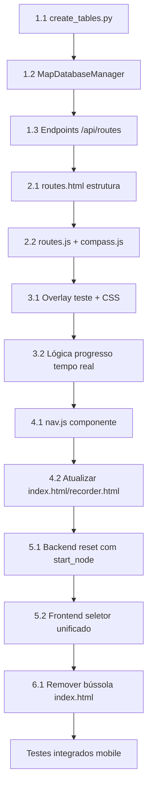

# Plano de Implementação: Nova Aba Rotas, Modo de Teste e Ponto de Partida Dinâmico

## Contexto e Objetivo

O projeto POV já possui bússola funcional e navegação por segmentos no `index.html`. O objetivo é **reorganizar a arquitetura de navegação** separando a visualização do mapa da experiência de teste de rotas em campo, além de tornar o ponto de partida configurável.

**Principais mudanças:**
1. Remover bússola do `index.html` → mover para nova página `routes.html`
2. Criar aba "Rotas" no menu superior (presente em todas as telas)
3. Implementar lista de rotas salvas com detalhes (origem, destino, passos, metros)
4. Criar "Modo de Teste" com bússola + progresso de passos em tempo real
5. Substituir "Recepção" fixo por seletor dinâmico de ponto de partida

---

## Arquitetura de Dados: Armazenamento de Rotas

### Problema Atual
O sistema **não persiste rotas nomeadas** — apenas checkpoints e arestas. Rotas são calculadas *on-demand* via Dijkstra. A tabela `sensors_log` armazena caminhadas brutas para criação de arestas, não rotas navegáveis.

### Solução: Nova Tabela `saved_routes`

```sql
CREATE TABLE IF NOT EXISTS saved_routes (
    id INT AUTO_INCREMENT PRIMARY KEY,
    name VARCHAR(100) NOT NULL,           -- Ex: "Recepção → Sala 101"
    start_node VARCHAR(100) NOT NULL,     -- FK checkpoints.name
    end_node VARCHAR(100) NOT NULL,       -- FK checkpoints.name
    total_distance_m FLOAT NOT NULL,      -- Soma das distâncias dos segmentos
    total_steps_estimated INT NOT NULL,   -- Estimativa: distance_m / 0.75m (passo médio)
    segments_json JSON NOT NULL,          -- Array completo dos segmentos (heading, distance, source, target)
    path_sequence_json JSON NOT NULL,     -- Lista ordenada de nós: ["A", "B", "C"]
    created_at TIMESTAMP DEFAULT CURRENT_TIMESTAMP,
    updated_at TIMESTAMP DEFAULT CURRENT_TIMESTAMP ON UPDATE CURRENT_TIMESTAMP,
    FOREIGN KEY (start_node) REFERENCES checkpoints(name) ON DELETE CASCADE,
    FOREIGN KEY (end_node) REFERENCES checkpoints(name) ON DELETE CASCADE
) ENGINE=InnoDB;
```

**Por que salvar segmentos completos (JSON)?**
- Evita recálculo no frontend
- Permite teste offline / sem backend
- Garante consistência entre o que foi salvo e o que é testado

---

## Fase 1: Backend — Persistência de Rotas e Novo Endpoint

### 1.1. Criar Tabela no Banco (Script Único)
**Arquivo:** `Backend/datasets/create_tables.py` (adicionar ao final)

```python
sql_saved_routes = """
CREATE TABLE IF NOT EXISTS saved_routes (
    id INT AUTO_INCREMENT PRIMARY KEY,
    name VARCHAR(100) NOT NULL,
    start_node VARCHAR(100) NOT NULL,
    end_node VARCHAR(100) NOT NULL,
    total_distance_m FLOAT NOT NULL,
    total_steps_estimated INT NOT NULL,
    segments_json JSON NOT NULL,
    path_sequence_json JSON NOT NULL,
    created_at TIMESTAMP DEFAULT CURRENT_TIMESTAMP,
    updated_at TIMESTAMP DEFAULT CURRENT_TIMESTAMP ON UPDATE CURRENT_TIMESTAMP,
    FOREIGN KEY (start_node) REFERENCES checkpoints(name) ON DELETE CASCADE,
    FOREIGN KEY (end_node) REFERENCES checkpoints(name) ON DELETE CASCADE
) ENGINE=InnoDB;
"""
db.execute_query(sql_saved_routes)
```

### 1.2. Estender `MapDatabaseManager`
**Arquivo:** `Backend/map/MapDatabaseManager.py`

| Método | Responsabilidade |
|--------|------------------|
| `save_route(name, start, end, segments, path_sequence)` | Persistir rota calculada |
| `get_all_routes()` | Listar todas salvas (para UI) |
| `get_route_by_id(route_id)` | Carregar rota completa para teste |
| `delete_route(route_id)` | Remover rota salva |

### 1.3. Novos Endpoints em `app.py`

| Endpoint | Método | Descrição |
|----------|--------|-----------|
| `/api/routes` | GET | Lista todas rotas salvas (resumo: id, name, start, end, distance, steps) |
| `/api/routes` | POST | Salvar nova rota (body: start, end, name_opcional) — calcula via router e persiste |
| `/api/routes/{route_id}` | GET | Retorna rota completa com segments_json para modo teste |
| `/api/routes/{route_id}` | DELETE | Remove rota salva |

**Lógica do POST `/api/routes`:**
1. Recebe `{start_node, end_node, name?}`
2. Chama `router.calculate_route_with_segments(start, end)`
3. Calcula `total_distance_m`, `total_steps_estimated = round(total_distance / 0.75)`
4. Gera `name` automático se não fornecido: `f"{start} → {end}"`
5. Persiste via `map_db_manager.save_route(...)`
6. Retorna rota salva com `id`

---

## Fase 2: Frontend — Nova Página `routes.html`

### 2.1. Estrutura da Página (`frontend/routes.html`)

```html
<!DOCTYPE html>
<html lang="pt-BR">
<head>
    <meta charset="UTF-8">
    <meta name="viewport" content="width=device-width, initial-scale=1.0, user-scalable=no">
    <title>POV - Rotas Salvas</title>
    <link rel="manifest" href="/manifest.json">
    <meta name="theme-color" content="#0f172a">
    <style>
        /* CSS compartilhado + específico de rotas */
        /* Menu superior fixo com 3 abas: Navegação | Mapeador | Rotas */
        /* Lista de cards de rota */
        /* Botão "Testar Rota" → entra em modo teste fullscreen */
    </style>
</head>
<body>
    <!-- MENU SUPERIOR FIXO (compartilhado) -->
    <nav class="top-nav">
        <a href="/" class="nav-btn">📍 Navegação</a>
        <a href="/recorder" class="nav-btn">🗺️ Mapeador</a>
        <a href="/routes" class="nav-btn active">📋 Rotas</a>
    </nav>

    <div class="container">
        <!-- CABEÇALHO -->
        <header class="page-header">
            <h1>Rotas Salvas</h1>
            <button id="btn-new-route" class="btn-primary">+ Nova Rota</button>
        </header>

        <!-- SELETOR DE PONTO DE PARTIDA DINÂMICO -->
        <div class="start-point-selector card">
            <label>📍 Meu Ponto de Partida Atual</label>
            <select id="start-point-select">
                <option value="">-- Selecione onde você está --</option>
            </select>
            <small id="start-point-hint" class="hint">Usado como origem ao criar/testar rotas</small>
        </div>

        <!-- LISTA DE ROTAS -->
        <div id="routes-list" class="routes-grid">
            <!-- Cards renderizados via JS -->
            <!-- Cada card: Nome, Origem → Destino, Distância, Passos, [Testar] [Editar] [Excluir] -->
        </div>

        <!-- MODAL: CRIAR NOVA ROTA -->
        <div id="modal-new-route" class="modal hidden">
            <div class="modal-content">
                <h3>Criar Nova Rota</h3>
                <div class="form-group">
                    <label>Origem</label>
                    <select id="new-route-start"></select>
                </div>
                <div class="form-group">
                    <label>Destino</label>
                    <select id="new-route-end"></select>
                </div>
                <div class="form-group">
                    <label>Nome (opcional)</label>
                    <input type="text" id="new-route-name" placeholder="Ex: Ida ao Auditório">
                </div>
                <div class="modal-actions">
                    <button class="btn-secondary" onclick="closeModal()">Cancelar</button>
                    <button class="btn-primary" onclick="createRoute()">Salvar Rota</button>
                </div>
            </div>
        </div>
    </div>

    <!-- MODO TESTE (Fullscreen Overlay) -->
    <div id="test-mode-overlay" class="test-mode hidden">
        <!-- Bússola grande + progresso de passos + botão "Finalizar Teste" -->
    </div>

    <script type="module" src="/static/js/routes.js"></script>
</body>
</html>
```

### 2.2. Arquivo JS Separado (`frontend/static/js/routes.js`)

**Módulos principais:**

| Função | Descrição |
|--------|-----------|
| `loadRoutes()` | Fetch `/api/routes` → render cards |
| `loadStartPoints()` | Fetch `/api/map` → popula `#start-point-select` e selects do modal |
| `createRoute()` | POST `/api/routes` com start/end selecionados |
| `enterTestMode(route)` | Mostra overlay `#test-mode-overlay` com bússola + progresso |
| `updateTestCompass()` | Loop: lê orientação + posição PDR → atualiza seta + progresso |
| `exitTestMode()` | Esconde overlay, limpa estado |

### 2.3. Componente Bússola Reutilizável (Compartilhado)

Criar `frontend/static/js/compass.js` (ES Module):

```javascript
export class Compass {
    constructor(containerId, options = {}) {
        this.container = document.getElementById(containerId);
        this.segments = [];
        this.currentSegmentIndex = 0;
        this.currentYawRad = 0;
        this.currentNode = null;
        this.onSegmentChange = options.onSegmentChange || (() => {});
        this.onDestinationReached = options.onDestinationReached || (() => {});
        this.render();
        this.bindOrientation();
    }

    render() { /* HTML da bússola: seta + círculo N/S/E/W + labels */ }
    
    bindOrientation() { /* DeviceOrientationEvent → this.currentYawRad */ }
    
    setRoute(segments) { /* this.segments = segments; this.currentSegmentIndex = 0 */ }
    
    update(currentNode) { 
        this.currentNode = currentNode;
        this.checkSegmentProgress();
        this.updateArrow();
    }
    
    checkSegmentProgress() { /* if currentNode === segment.target → advance */ }
    
    updateArrow() { /* delta = normalize(targetHeading - yaw) → rotate arrow */ }
}
```

---

## Fase 3: Modo de Teste em Tempo Real (Mobile/PWA)

### 3.1. Overlay de Teste (`#test-mode-overlay`)

```html
<div id="test-mode-overlay" class="test-mode hidden">
    <header class="test-header">
        <span id="test-route-name">Rota: Recepção → Sala 101</span>
        <button id="btn-exit-test" class="btn-danger">✕ Finalizar Teste</button>
    </header>
    
    <!-- BÚSSOLA GRANDE (centralizada, touch-friendly) -->
    <div class="test-compass-area">
        <div id="test-compass" class="compass-large"></div>
        <div class="test-target-info">
            <div id="test-current-segment">Recepção → Corredor A</div>
            <div id="test-segment-distance">Distância: 12.5m</div>
            <div id="test-direction-label" class="direction-large">⬆️ Frente</div>
        </div>
    </div>

    <!-- PROGRESSO DE PASSOS -->
    <div class="test-progress-bar">
        <div id="test-progress-fill" style="width: 0%"></div>
    </div>
    <div class="test-stats">
        <span>Passos: <b id="test-steps-count">0</b> / <b id="test-steps-total">17</b></span>
        <span>Distância: <b id="test-dist-current">0.0</b>m / <b id="test-dist-total">12.5</b>m</span>
    </div>

    <!-- STATUS SENSORES -->
    <div class="test-sensor-status">
        <span id="test-orientation-status">🧭 Orientação: Aguardando...</span>
        <span id="test-pdr-status">👣 PDR: Conectando...</span>
    </div>
</div>
```

### 3.2. Lógica de Progresso no Modo Teste

| Fonte de Dados | Uso |
|----------------|-----|
| `/api/current_location` (polling 500ms) | `currentNode` + `accumulated_distance_m` + `visited_path` |
| `DeviceOrientationEvent.alpha` | `currentYawRad` para rotação da seta |
| `route.segments_json` | Segmentos alvo com `heading_rad`, `distance_m` |
| `route.total_steps_estimated` | Meta de passos para barra de progresso |

**Algoritmo de Progresso:**
```javascript
// A cada polling (500ms):
const location = await fetchCurrentLocation();
compass.update(location.currentNode);

// Progresso do segmento atual:
const segment = compass.currentSegment;
const walkedInSegment = location.accumulated_distance_m; // Zera a cada nó?
const progressPercent = Math.min(100, (walkedInSegment / segment.distance_m) * 100);

// Passos estimados no segmento:
const stepsInSegment = Math.round(segment.distance_m / 0.75);
const stepsWalked = Math.round(walkedInSegment / 0.75);
```

> **Nota:** O `accumulated_distance_m` do matcher zera a cada nó visitado. Para progresso contínuo, somar distâncias dos segmentos já completos + distância acumulada atual.

---

## Fase 4: Integração — Menu Superior Compartilhado

### 4.1. Componente de Navegação Compartilhado

Criar `frontend/static/js/nav.js`:
```javascript
export function renderTopNav(activePage) {
    return `
    <nav class="top-nav">
        <a href="/" class="nav-btn ${activePage==='nav'?'active':''}">📍 Navegação</a>
        <a href="/recorder" class="nav-btn ${activePage==='map'?'active':''}">🗺️ Mapeador</a>
        <a href="/routes" class="nav-btn ${activePage==='routes'?'active':''}">📋 Rotas</a>
    </nav>`;
}
```

### 4.2. Atualizar `index.html` e `recorder.html`

- Remover bússola (`#panel-compass` e JS associado)
- Remover `mode-selector` inline
- Incluir `<script type="module">import {renderTopNav} from '/static/js/nav.js'; document.body.prepend(renderTopNav('nav'));</script>`
- Manter apenas: posição atual, seletor de destino, canvas do mapa

### 4.3. Novo Endpoint no Backend para Servir `routes.html`

**Em `app.py`:**
```python
@app.get("/routes")
def read_routes():
    routes_path = FRONTEND_DIR / "routes.html"
    if routes_path.exists():
        return FileResponse(routes_path)
    return {"error": "routes.html não encontrado"}
```

---

## Fase 5: Ponto de Partida Dinâmico (Variável)

### 5.1. Backend: Remover `starting_node` Fixo

**Em `app.py`:**
- Remover linha `starting_node = "Recepcao"`
- `TopologicalMatcher` deve aceitar `starting_node` como parâmetro no construtor
- Endpoint `/api/reset` deve aceitar `start_node` opcional no body

```python
@app.post("/api/reset")
def reset_session(start_node: str = Query(default="Recepcao")):
    global matcher, visited_path
    matcher = TopologicalMatcher(topo_map, starting_node=start_node)
    visited_path = [start_node]
    return {"status": "success", "start_node": start_node}
```

### 5.2. Frontend: Seletor Unificado

O `#start-point-select` em `routes.html` deve:
- Carregar todos checkpoints via `/api/map`
- Persistir escolha no `localStorage` (último usado)
- Ser usado como `start_node` ao:
  - Criar nova rota (modal)
  - Iniciar modo teste (chama `/api/reset?start_node=X`)
  - Navegação geral (futuro)

---

## Fase 6: Ajustes no `index.html` (Pós-Remoção da Bússola)

### 6.1. O que Remover
- `#panel-compass` (div inteira, linhas 63-136)
- Variáveis JS: `routeSegments`, `currentSegmentIndex`, `currentYawRad`
- Funções: `handleOrientation`, `updateCompass`, `checkSegmentProgress`
- `window.addEventListener('deviceorientation', ...)`
- Importação/uso de `normalizeAngle` (mover para `compass.js`)

### 6.2. O que Manter/Simplificar
- `#panel-nav` com posição atual + seletor de destino
- `fetchUserLocation()` polling (para mostrar posição no mapa)
- `onRequestRoute()` → chama `/api/compass_route` mas **apenas para desenhar linha verde no canvas**
- Canvas 2D com rota planejada + caminho real

### 6.3. Novo Fluxo `index.html`
1. Usuário vê mapa + posição atual
2. Seleciona destino → linha verde aparece no mapa
3. Para **testar/navergar** a rota → clica "Ir para Rotas" (link no menu) → `routes.html`

---

## Estrutura de Arquivos Finais

```
/home/leozera/Projects/ecosystem/POV---prototipo/
├── Backend/
│   ├── api/
│   │   ├── app.py                    # + endpoints /api/routes CRUD, reset com start_node
│   │   └── schema.py                 # + RouteCreateSchema, RouteResponseSchema
│   ├── datasets/
│   │   └── create_tables.py          # + tabela saved_routes
│   └── map/
│       └── MapDatabaseManager.py     # + save_route, get_all_routes, get_route_by_id, delete_route
├── frontend/
│   ├── index.html                    # SEM bússola, COM menu superior compartilhado
│   ├── recorder.html                 # COM menu superior compartilhado
│   ├── routes.html                   # NOVA: lista rotas + modo teste
│   └── static/
│       └── js/
│           ├── nav.js                # NOVO: menu superior compartilhado
│           ├── compass.js            # NOVO: classe Compass reutilizável
│           └── routes.js             # NOVO: lógica da página routes.html
├── auditoria/
│   ├── auditoria-001.md              # (existente)
│   └── auditoria-002.md              # (este plano)
```

---

## Testes e Validação

### Backend
```bash
# 1. Criar tabelas
cd Backend && python datasets/create_tables.py

# 2. Iniciar servidor
uvicorn api.app:app --reload --port 8000

# 3. Testar endpoints
curl -X POST "http://127.0.0.1:8000/api/routes" \
  -H "Content-Type: application/json" \
  -d '{"start_node": "Recepcao", "end_node": "Sala 101"}'

curl "http://127.0.0.1:8000/api/routes"
curl "http://127.0.0.1:8000/api/routes/1"
```

### Frontend (Mobile Real)
1. Acessar `https://seu-dominio/routes` no celular
2. Selecionar "Meu Ponto de Partida" no dropdown
3. Ver lista de rotas salvas (ou criar nova)
4. Clicar "Testar" em uma rota
5. **Validações críticas:**
   - [ ] Bússola gira suavemente ao rotacionar celular
   - [ ] Seta aponta para direção correta do próximo segmento
   - [ ] Ao chegar no nó intermediário, segmento avança automaticamente
   - [ ] Barra de progresso reflete passos/distância percorrida
   - [ ] "Finalizar Teste" volta para lista sem erros

### Edge Cases
| Cenário | Tratamento |
|---------|------------|
| Sem permissão de orientação (iOS) | Botão "Calibrar Bússola" → `DeviceOrientationEvent.requestPermission()` |
| Rota com 1 segmento | Funciona normalmente (origin → dest direto) |
| Usuário sai da rota (nó inesperado) | Mostrar aviso "Fora da rota", recalcular se necessário |
| Dispositivo sem bússola (desktop) | Mock: teclas ←/→ rotacionam `currentYawRad` para teste |

---

## Estimativa de Esforço

| Fase | Tarefa | Esforço |
|------|--------|---------|
| 1 | Backend: tabela + Manager + endpoints | ~3h |
| 2 | Frontend: routes.html + JS + CSS | ~4h |
| 3 | Modo Teste (overlay + bússola + progresso) | ~3h |
| 4 | Menu compartilhado + limpeza index.html | ~2h |
| 5 | Ponto de partida dinâmico (backend + frontend) | ~2h |
| 6 | Testes em dispositivo real + ajustes | ~3h |
| **Total** | | **~17h** |

---

## Dependências e Ordem de Execução



---

## Riscos e Mitigações

| Risco | Probabilidade | Impacto | Mitigação |
|-------|---------------|---------|-----------|
| `DeviceOrientationEvent` não funciona em alguns Android | Média | Alto | Fallback: botão manual "Girar ← / →" para simular yaw |
| `accumulated_distance_m` zera a cada nó → progresso salta | Alta | Médio | Calcular progresso acumulado: `sum(segmentos_completos) + atual` |
| Rotas salvas ficam obsoletas se grafo mudar | Baixa | Médio | Adicionar `version` na rota; ao carregar, validar se nós/arestas ainda existem |
| PWA offline no modo teste | Baixa | Alto | Service Worker + cache de `routes.html`, `compass.js`, `manifest.json` |

---

## Próximos Passos Imediatos

1. **Executar** `python Backend/datasets/create_tables.py` (cria tabela `saved_routes`)
2. **Implementar** `MapDatabaseManager.save_route()` e `get_all_routes()`
3. **Adicionar** endpoints `/api/routes` em `app.py`
4. **Criar** `frontend/routes.html` com estrutura base + menu superior
5. **Extrair** bússola para `compass.js` (reutilizável)
6. **Integrar** modo teste com polling PDR + orientação

---

## Referências de Código Existente para Reutilizar

| Funcionalidade | Arquivo | Localização |
|----------------|---------|-------------|
| Bússola CSS/JS | `index.html` | Linhas 63-136, 195-312 |
| DeviceOrientation | `recorder.html` | Linhas 277-284 |
| Polling localização | `index.html` | Linhas 352-368, 481 |
| Dijkstra + segmentos | `router.py` | `calculate_route_with_segments()` |
| Salvamento arestas | `MapDatabaseManager.py` | `save_edge()` |
| Carregamento nós | `index.html` | `populateSelects()` |
| Modal patterns | `recorder.html` | Histórico cards (linhas 339-356) |